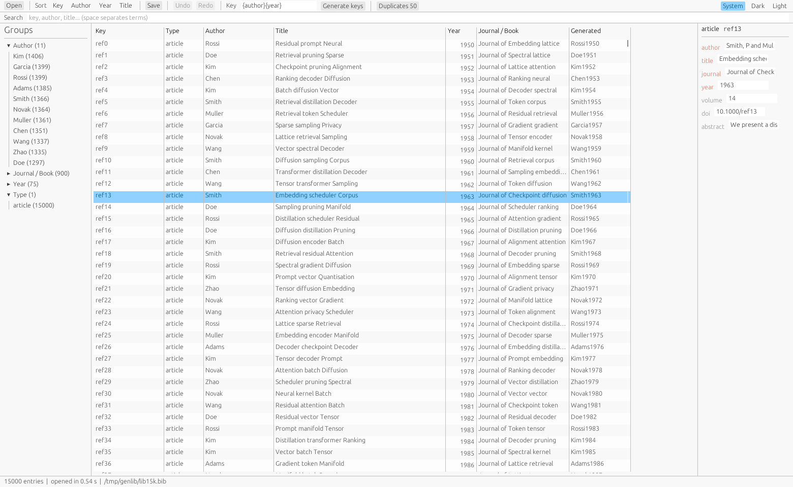
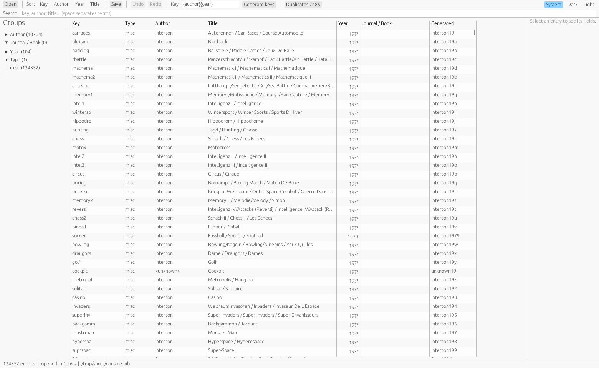

# citerack

A reference manager for people whose bibliography outgrew their tool. It opens a
BibTeX file of a hundred thousand entries in about two seconds, and it never
rewrites a byte it did not change.

The problem it addresses is narrow and concrete: a library that has grown for
twenty years is a file that a general-purpose tool parses on the thread that
draws the window, so the window is a white rectangle for as long as the parse
takes, and the tool has no way to tell the user which of the two is the problem.
citerack separates those two: the file is read on a worker thread, the index is
built before the first row is drawn, and the window reports both.

## What it does today



| | |
| --- | --- |
| Reads | BibTeX, including fields it does not model, which survive a save |
| Edits | any field in place, with `Ctrl+Z` over a run of typing; a field the entry's type needs but the file lacks is named and added |
| Saves | byte-identically when nothing was edited |
| Searches | case- and accent-insensitive, over every field, in about 0.16 ms at 15 000 entries and 1.0 ms at 100 000 for a word; a four-word query costs a few milliseconds |
| Filters | by author, journal, year and type, with a count that is what the filter would actually leave |
| Sorts | key, first author, year, title, without re-reading an entry |
| Names | a duplicate by DOI, or by title and year with case, accents, braces and punctuation folded away |
| Keys | generated from a pattern such as `{author}{year}`, previewed before the file moves |
| Opens | a paper from a `file` field with one press, whoever wrote the path; one that is not there is marked beside the field |
| Batches | one field written across a picked range with a typed name and value, as one undo step |
| Imports | an entry from a DOI or an arXiv id, typed or pasted as a link, filed under a key nothing else holds |
| Shows | a table with key, type, author, title, year and venue, and a detail pane per entry |

Everything here is measured, and `docs/Performance.md` has the machine and the
command that re-derives each figure. A real user's 134 352-entry library, attached
to a bug report about slow scrolling elsewhere, opens in about a second:



Bulk editing, importing from a DOI, attachments and a translated interface are on
the [roadmap](docs/Roadmap.md).

## Install

Every tagged release publishes a Linux binary and a Windows one, each with a
`.sha256` beside it. The newest is
[`v0.1.1`](https://github.com/emfox/citerack/releases/latest). Download it and run
it; on a Linux desktop nothing has to be installed first, because the binary links
only `libc`, `libm` and `libgcc_s` and loads the window stack — X11, Wayland, GL,
Vulkan — from whatever the desktop already has.

From a checkout instead. Beyond a Rust toolchain and a C linker, nothing has to be
installed: every window library the build touches — X11, Wayland, xkbcommon, GL,
EGL — is reached through a `dlopen` feature, so nothing is probed or linked while
compiling.

```bash
cargo build --release -p citerack
./target/release/citerack library.bib
```

The binary that comes out links `libc`, `libm` and `libgcc_s` and nothing else;
`scripts/check_linux_links.sh` fails the build if that ever stops being true.

On Windows the build targets MSVC with the runtime linked statically, so the exe
needs no redistributable. It has no signature, so Windows may ask before running
it; the checksum is how to tell it apart from anything else with that name.

A window is drawn with OpenGL and, on a machine that will not give it a GL
context, with Vulkan or DX12 instead, so a broken GL driver is not a reason to
refuse to start. On Linux that second path needs a Vulkan loader, usually already
present as `libvulkan1`.

Nothing has to be installed beside the binaries: the Windows exe binds only
libraries that every Windows has. The shader compiler the DX12 path needs
is taken from the system directory if it is there, and the path is left out if it
is not.

## Use

```bash
citerack library.bib                  # open a window
citerack                              # open a window, then pick a file
citerack --open-time library.bib      # parse and index, print the timings
citerack --search "zhou 2024" library.bib
```

The measuring flags need no display, which is how the figures in
[docs/Performance.md](docs/Performance.md) are produced and how a bug report can
quote a number that means something: `--open-time`, `--edit-time`, `--save-time`,
`--search`, `--explain` and `--index-report`. The last two say where a query spent
its rows, and where the index spent its memory.

In the window: `Ctrl+O` opens a library, `Ctrl+S` saves it, `Ctrl+F` reaches the
filter box, and `Ctrl+Z` and `Ctrl+Shift+Z` take back and put back an edit.
`Up` and `Down` walk the table, `Ctrl+D` reaches the fields of the selected entry,
and `Tab` walks them. Nothing needs a mouse.

`System`, `Dark` and `Light` at the right end of the toolbar choose the theme; the
window opens following the desktop.

## How it is built

Four crates, one dependency direction:

```
bib  ->  index  ->  store  ->  app
```

`bib` parses and writes. `index` folds, matches and sorts. `store` owns the
`Session` and is the only crate that touches disk. `app` is the only crate that
knows a screen exists. Everything below `app` runs headless, so the path a click
takes is the path the tests take.

[docs/Architecture.md](docs/Architecture.md) explains why each boundary is where
it is; [docs/Ui-spec.md](docs/Ui-spec.md) says what the window shows and why.

## Contribute

```bash
sh scripts/install-hooks.sh      # once per clone
python3 scripts/check_all.py     # every gate this machine can run
```

Commit messages, comment density and the English-only rule for source are held by
scripts rather than by memory; [docs/Conventions.md](docs/Conventions.md) states
them and `scripts/check_all.py` enforces them.
